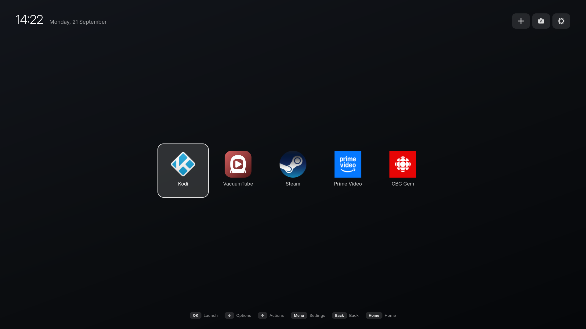
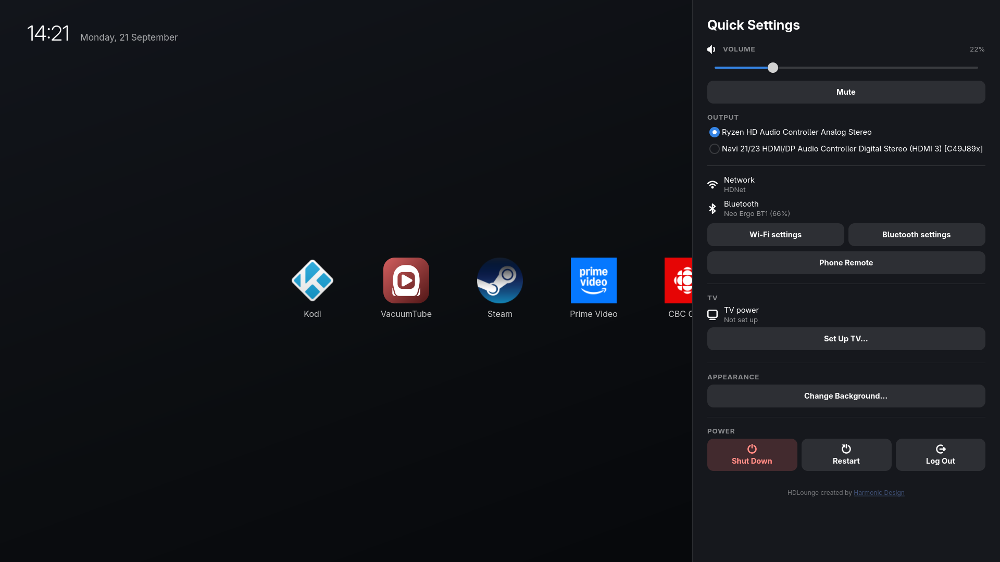

# HDLounge

A minimal, keyboard- and remote-driven fullscreen launcher for GNOME. Built as
a an alternative for KDE Plasma Bigscreen on a GNOME PC. Turn your old laptop into a smart TV or home server!

> **Requires GNOME Shell 50/51 on Wayland** (developed against Fedora 44 /
> GNOME 50.4). The shell extension declares `shell-version: ["50", "51"]`. See
> [Requirements](#requirements).





## What is HDLounge?

HDLounge is a fullscreen app + extension you can install onto your GNOME system that is meant to replace your smart tv interface, or streaming boxes like the NVIDIA SHIELD. This is NOT meant to be used as a desktop (although you can continue to use it as such if needed), and is instead best used when you pair a bluetooth remote control or gamepad for navigation.

I've been wanting to build something like this for years, and since I had a lot of fun playing with the new Plasma Bigscreen, I felt that now was as good a time as any to get crackin' at it.

AI was used in this project, primarily for debugging and writing tests, but the core of this was human written.

## What it does

HDLounge allows you to use a keyboard, bluetooth remote control, or gamepad to navigate a simple homescreen/app drawer to launch whatever apps you want. Most apps launched this way will open full screen, so this works amazing for things like Vacuumtube (YouTube), Kodi, Plex, Retrodeck, etc.

- Fullscreen home screen with a customizable background image
- A single drawer of pinned apps, navigated with arrow keys
- Launched apps are forced fullscreen
- Running indicators under each tile
- Per-app options (close, **force kill**, fullscreen toggle, reorder, unpin) via
  Down or by holding OK
- Apps running without being pinned (Settings, Software, a game Steam
  started) get a tile of their own past a divider
- Website tiles for streaming services with no Linux app (Netflix, Prime
  Video, Disney+, Crave, CBC Gem, or any address), opened in Google Chrome
- Driveable entirely from a TV remote (D-pad, OK, Back, Home, Menu) or a
  game controller
- Cursor hides itself after 10 seconds of no movement
- **Turns the TV itself off and on over the network** when the screen blanks
  and wakes, for the many PCs with **no HDMI-CEC** (**LG webOS only**. Feel free to contribe for other brands)
- Quick settings: volume, **audio output device**, network + Bluetooth status
  (with battery levels), Phone Remote pairing when GSConnect is installed,
  TV power, background
- Anything opened from quick settings or the action bar is raised and focused
  even if it is already running behind the launcher

## Architecture, and why there are two halves

```
┌──────────────────────────────┐        ┌───────────────────────────────┐
│  hdlounge-launcher (GTK4/Py) │ D-Bus  │  hdlounge@harmonicdesign.ca   │
│  the UI you see              │◄──────►│  GNOME Shell extension        │
│                              │        │  the privileged half          │
│  drawer, quick settings,     │        │  launch/focus, fullscreen,    │
│  config, background          │        │  minimise, close, kill, kiosk │
└──────────────────────────────┘        └───────────────────────────────┘
```

**Q**. Why Python? **A**. The best tool is the one you know hoiw to use.

On Wayland, an ordinary application **cannot** enumerate other windows, focus
them, minimize them, fullscreen them or kill them. Those are compositor
privileges. So all window management lives in a GNOME Shell extension that
exposes a private D-Bus interface at `ca.harmonicdesign.HDLounge.Shell`, and the
GTK4 app drives it.

## Requirements

-  GNOME Shell 50 / 51 on Wayland (developed and tested Fedora 44 and Gnome Shell against 50.4)
- `python3-gobject`, GTK 4, libadwaita
- `wireplumber` (`wpctl`) and `pulseaudio-utils` (`pactl`) for audio controls
- `curl`, to fetch website-tile icons and to install GSConnect
- `libmanette` (optional) for game controllers

```sh
sudo dnf install python3-gobject gtk4 libadwaita wireplumber pulseaudio-utils curl
```

## Install

```sh
./install.sh
```

This installs the launcher to `~/.local/share/hdlounge`, links `~/.local/bin/hdlounge`,
installs the extension to `~/.local/share/gnome-shell/extensions/`, enables the
extension by writing the `enabled-extensions` gsetting directly, and installs a
**systemd user service** (`hdlounge.service`) that starts the launcher with the
graphical session.

**Reboot** so that the extension can load in right, and any systemmd stuff can load (such as controller support) 

```sh
gnome-extensions info hdlounge@harmonicdesign.ca   # expect State: ACTIVE
systemctl --user status hdlounge.service           # expect active (running)
```

### What the installer asks

| Question | Variable | What "yes" does |
| --- | --- | --- |
| Pair a Bluetooth TV remote now | `HDLOUNGE_PAIR=1` | Scans, lists what it finds, then pairs, **trusts** and connects the one you pick. Trusted means it reconnects by itself after a restart |
| Make the remote's OK, Menu and Power buttons work in every app | `HDLOUNGE_REMOTE=1` | Installs [the SHIELD remote hwdb rule](#making-ok-work-in-the-apps-hdlounge-launches) to `/etc/udev/hwdb.d/` (needs `sudo`). A remote paired just before also gets its own keymap, `61-hdlounge-remote-<vendor>-<product>.hwdb`, with the same OK, Menu and Power remap, so any Android TV-style remote works |
| TV power over IP | `HDLOUNGE_TV_POWER=1` | Finds the LG TV on the network (or uses `HDLOUNGE_TV_HOST`), pairs with it — the TV asks you to allow HDLounge — and stores the address, MAC and key in `config.json`. From then on the TV switches off when the screen blanks and back on when it wakes. See [TV power over IP](#tv-power-over-ip) |
| Never sleep or lock | `HDLOUNGE_NOSLEEP=1` | No suspend and no lock screen. The screen still blanks after `HDLOUNGE_BLANK_MINUTES` (default 30; `0` means never). So a static home screen cannot burn into an OLED or the TV can auto power off. Video playback stops screen blanking, and any button wakes the screen |
| Automatic login | `HDLOUNGE_AUTOLOGIN=1` | Sets `AutomaticLogin` for you in `/etc/gdm/custom.conf` (needs `sudo`), so a restart or power cut comes straight back to HDLounge instead of a password prompt |
| SSH | `HDLOUNGE_SSH=1` | `systemctl enable --now sshd` (needs `sudo`), so the box can be fixed from another computer |
| GSConnect | `HDLOUNGE_GSCONNECT=1` | Installs [GSConnect](https://extensions.gnome.org/extension/1319/gsconnect/) from extensions.gnome.org, so a phone running KDE Connect becomes a keyboard, touchpad and media remote |
| TV apps | `HDLOUNGE_INSTALL_APPS=1` | Offers to install Kodi, VacuumTube, Steam, and Retrodeck. |
| Website tiles | `HDLOUNGE_WEBSITES=1` | Asks about Netflix, Prime Video, Disney+, Crave, and CBC Gem, and creates tiles for each one |
| Restart when done | `HDLOUNGE_REBOOT=1` | Restarts after a 10-second countdown (Ctrl+C cancels) |


**Automatic login and the keyring.** With no password typed at login,
nothing unlocks the login keyring, so Chrome and Electron apps such as
VacuumTube will ask for it. To stop that, open Passwords and Keys
(`org.gnome.seahorse.Application`), right-click **Login**, choose **Change
Password** and leave the new one blank. The trade-off is that saved passwords
are then stored unencrypted on this machine.

**SSH.** Password logins work straight away. For something safer, copy a key
over with `ssh-copy-id` and use that instead.

The installer records the system changes it actually made in
`~/.config/hdlounge/installer-state`: automatic login, and SSH if it was not
already on. `uninstall.sh` reverts (NOTE: In theory).

## Keys

Everything is reachable from a plain D-pad — no letter keys required.

| Button | Action |
| --- | --- |
| `←` `→` | Move between apps (dismisses an open options menu) |
| `OK` / `Enter` | Launch, or focus if already running |
| `↓` | Options for the focused app |
| `↑` | Action bar: Add App / Get More Apps / Settings (the focused one names itself in a bubble) |
| **Hold** `OK` (~0.5s) | Options (same as `↓`) |
| `Menu` | Quick settings |
| `Back` / `Esc` / `Backspace` | Close the current panel |
| `Home` | Minimise everything, return here |
| `Power` | TV off, or on again — never the PC ([TV power over IP](#tv-power-over-ip)) |
| Volume / Mute | Audio |

Keyboard accelerators, for when there is a keyboard attached:

| Key | Action |
| --- | --- |
| `S` / `F2` | Quick settings |
| `A` / `Insert` | Add an app |
| `B` | Change background image |
| `Ctrl`+`Q` | Quit the launcher (deliberate exit from kiosk) |

### Game controllers

Any controller libmanette has a mapping for (Xbox, PlayStation, Switch Pro,
8BitDo and so on) drives the launcher like a remote:

| Controller | Action |
| --- | --- |
| D-pad / left stick | Move (repeats while held) |
| `A` | OK |
| `B` | Back |
| `Y` / `X` | Options for the focused app |
| `Start` | Quick settings |
| **Hold** `Guide` (~0.6s) | Home, from inside any app |

Inside a running app only Home gets through. Every other button is ignored
unless the launcher has focus, so the game keeps its controller. A *tap* on
Guide is left alone, because Steam uses it to open its overlay.

### Remote control notes

Remote keysyms are handled alongside their keyboard equivalents:
`XF86HomePage`, `XF86Back`, `XF86MenuKB`, `XF86MenuPB`, `XF86Tools`,
`XF86Explorer`, `XF86AudioMute`, `XF86AudioRaiseVolume`,
`XF86AudioLowerVolume`, `XF86SelectButton`.

#### The OK button is not Enter

An Android TV remote -- the NVIDIA Shield remote and the many clones of it --
does not send `Return` for OK. It sends evdev `KEY_SELECT` (353), which
arrives as `XF86SelectButton` (`0x1008ffa0`), the keysym X11 documents as
*"Select button on joypads and remotes"*.

The problem is that GTK activates a focused widget on `Return`,
`KP_Enter` and `space` through its own key bindings, and has **no** binding
for this keysym.

#### Remapping remote controls

Use [61-nvidia-shield-remote.hwdb](61-nvidia-shield-remote.hwdb), as a template for your own bidings to map things out as needed.

```sh
sudo python3 test-support/keyprobe.py --evdev    # press buttons
```

## Configuration

`~/.config/hdlounge/config.json`

```json
{
  "background": "/home/you/Pictures/wallpaper.jpg",
  "background_dim": 0.55,
  "clock_24h": true,
  "apps": [
    { "id": "org.gnome.Ptyxis.desktop", "fullscreen": true }
  ],
  "tv": {
    "enabled": true,
    "host": "192.168.1.42",
    "mac": "aa:bb:cc:dd:ee:ff",
    "key": "3d1f...the key the TV handed back"
  }
}
```

- `background` — absolute path, or `null` for the built-in gradient
- `background_dim` — 0..1 scrim over the image, for text legibility
- `apps[].fullscreen` — force this app fullscreen when launched
- `tv` — the television, controlled over the network; see
  [TV power over IP](#tv-power-over-ip). `enabled` false leaves it paired but
  stops HDLounge touching it

I plan to extend this to allow for more customizations such as icon size, padding and spacing, etc.

## TV power over IP

TV's use HDMI-CEC to automatically turn a TV on or off, but almost no PC will 
have CEC support. This means that you have three options.

1. Look in your TV settings and see if there is an idle turn off setting or similar. This way if the screen blanks, at least your TV won't stay powered on forever.
2. Keep two remotes. The original TV remote to turn it on and off, and the second remote to control HDLounge.
3. If you have an modern LG TV, we can actually control it over IP.

For LG TVs with WebOS, set it up during install, or later from **quick settings → TV → Set Up TV**,
which searches the network and pairs with the one you pick. The TV shows an
accept prompt the first time; press OK on it with the TV's own remote. What
comes back is stored in `config.json` and never expires, so it only happens
once.

**The TV needs one setting changed, or it can switch off, but not on via remote**. Turning a TV off is a command over the network, but once off, it has stopped listening to the network (theoretically, RIGHT LG???). The only thing that wakes
it is a Wake-on-LAN packet, and webOS ignores those unless **Mobile TV On**
is enabled.

Settings → General → Devices → TV Management → Mobile TV On
(older sets call it **Quick Start+**). It is dependable over Ethernet; over
Wi-Fi it depends on the model.

Once setup, the remote's **Power** button switches the TV off and on too!

NOTE: Other brands have a similar feature. If you have a Samsung or some other brand,
please feel free to contribute integration for this.

## Escape hatch

Kiosk mode hides the top panel and suppresses the Activities overview. If you
need stock GNOME back:

```sh
SCHEMAS=~/.local/share/gnome-shell/extensions/hdlounge@harmonicdesign.ca/schemas
gsettings --schemadir $SCHEMAS set org.gnome.shell.extensions.hdlounge kiosk-mode false
```

Or disable the extension entirely:

```sh
gnome-extensions disable hdlounge@harmonicdesign.ca
```

Both take effect immediately — no logout needed. If you are ever fully locked
out, switch to a TTY with `Ctrl`+`Alt`+`F3` and run the command there.

## Uninstall

```sh
./uninstall.sh
```

Removes everything and restores the GNOME settings the installer changed. It
also undoes the system changes the installer recorded:

- the remote keymaps
- automatic login
- SSH, which is disabled for the next boot but not stopped, in case you are
  connected over it

Your config at `~/.config/hdlounge/`, apps installed from Flathub, GSConnect and
Bluetooth pairings are left alone.

## Troubleshooting

### The keyboard does nothing, but the mouse works

That combination means the launcher window does not hold Wayland **keyboard
focus** — pointer events go to whatever is under the cursor regardless of
focus, so the mouse keeps working while every keystroke goes nowhere.

A Wayland client cannot focus itself, so the extension does it (`FocusLauncher`).
If this happens, the extension is almost certainly not running:

```sh
gnome-extensions info hdlounge@harmonicdesign.ca   # expect State: ACTIVE
```

The launcher shows a "Shell extension not running -- keyboard disabled" chip in
the top right whenever it cannot reach the extension.

If it reports `State: OUT OF DATE`, GNOME Shell has been upgraded past the
versions listed in the extension's `metadata.json` (`shell-version`). The
installer warns about this up front; add the new major version there, re-run
`./install.sh` and log in again.

### Nothing starts on login

```sh
systemctl --user status hdlounge.service
journalctl --user -u hdlounge.service -b --no-pager | tail -30
```

### Layout

```
app/
  hdlounge-launcher            entry point
  hdlounge/
    main.py                Adw.Application, CSS loading
    window.py              home screen, global keys, panels
    drawer.py              app tiles, long-press, running indicators
    quicksettings.py       volume, output, network/BT, TV, power
    picker.py              add-an-app dialog, including Add a Website
    webapps.py             website tiles: desktop entries for browser app windows
    gamepad.py             game controllers -> navigation actions (libmanette)
    tvpower.py             TV off with the screen, on when it wakes
    webos.py               the LG webOS protocol, hand-rolled on Gio sockets
    blank.py               notices GNOME blanking and unblanking the screen
    config.py              ~/.config/hdlounge/config.json
    bridge.py              D-Bus client for the extension
    audio.py               wpctl / pactl
    system.py              logind power, nmcli, BlueZ
    proc.py                async subprocess helper
    appinfo.py             Gio/GioUnix DesktopAppInfo shim
    keynav.py              row-based D-pad navigation and OK activation,
                           shared by both panels
    bubble.py              tooltip-on-focus for the icon-only buttons
    debugshot.py           env-gated self-screenshot + key tracing (testing only)
    style.css
shell-extension/hdlounge@harmonicdesign.ca/
  extension.js             D-Bus service, window management, kiosk mode
  schemas/                 gsettings schema
test-support/
  hdloungeinject@test/
    extension.js           TEST ONLY key injector; never installed
  keyprobe.py              what does this remote button actually send?
  test_gamepad_mapping.py  controller mapping, on a fake clock
  test_webos_framing.py    the TV's wire format, without a TV
  test_tv_power.py         TV off with the screen, on a fake clock
  test_config.py           pins that survive a missing app, a broken config
```

### Notes

- The launcher ignores its own close request; `Ctrl`+`Q` is the way out. It IS
  the desktop, so a stray `Alt`+`F4` should not leave a blank screen.
- "close" window decoration not navigatable on GNOME windows (example, Nautilus).
  You can always go home and then close apps like this from the tile.
- I've been dailying this for almost a month, but everyone's usecase is different
  and i'm sure you'll encounter issues and inconveniences. 
  Feel free to open an issue or contribute. 
